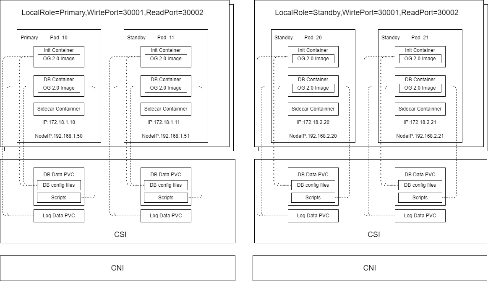
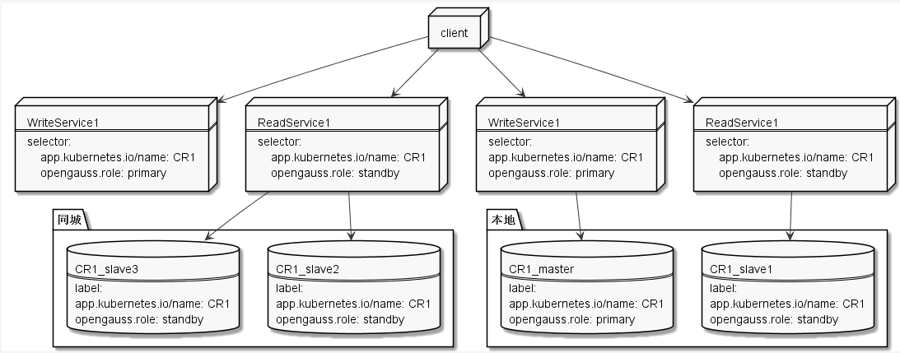
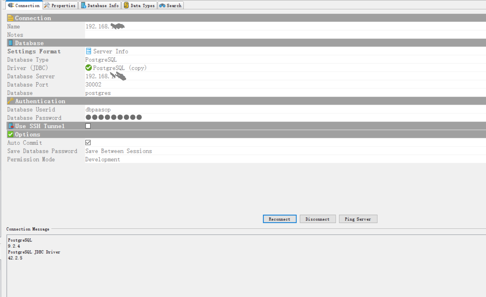

  
# openGauss-operator

## Release Notes

Based on version 1.0, Operator 2.0 inherits previous capabilities while introducing functional optimizations. Specifically:

1. Pod Health Checks: Optimized the pod health query timeout mechanism. The liveness probe has been removed, and the readiness probe has been switched from script execution to a TCP DB port check.

2. Plugin Support: Added support for new network and storage plugins, specifically Calico and Kube-OVN for networking, and TopoLVM and Huawei distributed storage for storage. Hybrid plugin deployment is now supported, allowing openGauss clusters to be deployed across Kubernetes environments using different network and storage plugins.

3. Failover Logic: Optimized the selection logic for openGauss clusters when no primary node exists.

4. Standby Database Build: Updated the method for building standby databases. The logic has shifted from using `gs_basebackup` to the `build` method.

5. Storage Plugin Resilience: Optimized the pod creation process for the distributed storage plugin. If a pod fails to start due to a `failmount` error, the system will wait until the PVC can be successfully mounted.

6. Network Configuration: In Kube-OVN environments, pods can now be configured with multiple NICs. This allows a single pod to hold two IP addresses for distinct purposes, such as service provision and backups.

7. Logging: Enhanced log output to facilitate troubleshooting of production issues.

8. Bug Fixes: Fixed an issue where the `replconninfo` configuration was not updated correctly after the openGauss cluster instance format changed in specific scenarios.

9. Startup Script: Modified the pod DB container startup script to display usage statistics for both the log PVC and storage PVC.

10. Scheduling & Probes: Added pod scheduling policies to support deployment on specific nodes. Additionally, the periods for liveness and readiness probes are now configurable.

11. Storage Monitoring: Added monitoring for data PVC usage. When usage reaches a specific threshold, the data PVC is set to `read-only` (setting `default_transaction_read_only` to `on`). This setting automatically reverts to `off` after a scale-out operation.

## Overview

### Operator Introduction
> openGauss Operator is a tool designed for installing and maintaining openGauss clusters on Kubernetes. Its core capabilities cover the full lifecycle management of the database, including cluster deployment, maintenance, topology consistency, resource upgrades, horizontal scaling, and local failover.

#### Overall Architecture


1. Init Container
    1. Image: openGauss
    2. Function: Initializing database parameters and modifying configurations
2. openGauss Container
    1. Image: openGauss
    2. Function: Mounting the `Data` directory of `Init Container`
3. Sidecar
    1. Images: openGauss & Filebeat
    2. Functions:
        1. Configuring the database data directory and backup directory
        2. Performing full backup and log output for `gs_basebackup`
#### Read/Write Splitting

>Read/write splitting is implemented by applying labels to services and pods.
Operator assigns primary or standby labels to the corresponding pods in the openGauss cluster. Services are then routed based on these labels: the write service targets the pod labeled primary, while the read service targets all pods labeled standby. Clients can access the IP address and NodePort of any Kubernetes node to achieve read/write splitting.
### Functions
openGauss Operator supports the following functions:
- Cluster deployment (single-node, multi-node, and intra-city DR deployment)
- Cluster scale-out
- Cluster scale-in
- Cluster node migration
- Cluster resource upgrade (rolling upgrade of CPU, memory, storage, and bandwidth of a cluster)
- Intra-city switchover
- Manual maintenance
- Cluster deletion
### Supported Environments
- Machine architecture
  - Linux version 3.10.0-957.el7.x86_64
- CNI type
  - Calico and Kube-OVN. In Kube-OVN environments, pods can be configured with multiple NICs. This allows a single pod to hold two IP addresses for distinct purposes, such as service provision and backups.
- CSI type
  - `HostPath`
  - TopoLVM
  - Huawei distributed storage
  - Hybrid plugin deployment is supported, allowing openGauss clusters to be deployed across Kubernetes environments using different network and storage plugins.


## [Installation](doc/how_to_deploy_operator.md)

### Base Image
1. Download the openGauss image.

```bash
wget https://gitee.com/opengauss/openGauss-operator/releases/download/2.0/opengauss-operatorv2.tar
docker load -i opengauss-operatorv2.tar
```
2. Download the Operator image.

```bash
wget https://gitee.com/opengauss/openGauss-operator/releases/download/2.0/opengauss-5.0.2-docker.x86_64.tar
docker load -i opengauss-5.0.2-docker.x86_64.tar
```
### Single-Node Deployment
1. Deploy Operator.

```bash
make deploy IMG=opengauss-operator:v2.0.0
```
2. Compile the openGauss cluster configuration file `sample.yaml` and start the cluster.

```bash
kubectl apply -f sample.yaml 
```
`sample.yaml`

```
apiVersion: opengauss.sig/v1
kind: OpenGaussCluster
metadata:
  name: ogtest01     #The pod name, which is customizable.
spec:
  cpu: '2'
  storage: 10Gi
  image: opengauss-5.0.2:latest
  memory: 3G
  readport: 31000
  writeport: 31001
  localrole: primary
  dbport: 26000
  hostpathroot: /docker/opengauss_operator/ogtest01    #The root path of the local storage. Set this parameter when the local storage is used.
  #storageclass: topolvm-class    #The storageclass of the corresponding storage plugin.
  networkclass: calico     #Calico and Kube-OVN are supported.
  config:
    advance_xlog_file_num: "10"
    archive_command: '''cp %p /gaussarch/archive/%f'''
    archive_dest: '''/gaussdata/archive/archive_xlog'''
    archive_mode: "on"
    bbox_dump_path: '''/gaussarch/corefile'''
    log_directory: '''/gaussarch/log/omm/pg_log'''
    max_connections: "2000"
  iplist:
  - nodename: node    # The host name.
    ip: 192.170.0.110  # The pod ID, which is customizable.
```

For details about how to build a compilation image, see [Deployment Details](doc/how_to_deploy_operator.md)

## User Guide
### Custom Resource Definitions (CRDs)
The following table lists the main attributes of CRDs.
| **Attribute**  | **Attribute Type**| **Description**                    |
| -------------- | ------------ | -------------------------------- |
| ReadPort       | Int          | The NodePort read port                  |
| WritePort      | int          | The NodePort write port                  |
| DBPort         | int          | The openGauss instance port               |
| DBPasswd       | string       | The openGauss instance password               |
| Image          | string       | The openGauss image path               |
| LocalRole      | string       | The cluster role, which can be `primary` or `standby`     |
| CPU            | string       | The CPU limit of the openGauss instance            |
| Storage        | string       | The storage limit of the openGauss instance           |
| Memory         | string       | The memory limit of the openGauss instance           |
| BandWidth      | string       | The bandwidth                            |
| IpList         | IpNodeEntry  | The IP address and worker node name of the openGauss instance |
| RemoteIpList   | []string     | The instance IP address list of the intra-city cluster            |
| BackupPath     | string       | The local backup path                    |
| ArchiveLogPath | string       | The local archive path                    |
| HostpathRoot   | string       | The local storage path (required when the local storage is used)|
| StorageClass   | string       | The storage plugin type                    |
| SidecarImage   | string       | The Sidecar image path                 |
| SidecarCPU     | string       | The Sidecar CPU limit                 |
| SidecarMemory  | string       | The Sidecar memory limit                 |
| SidecarStorage | string       | The Sidecar storage limit                 |
| Maintenance    | bool         | The cluster maintenance mode                    |
| ScriptConfig   | string       | Script execution configurations                  |
| FilebeatConfig | string       | Configuring CM for Filebeat                  |
#### Configuring ConfigMaps
When deploying a cluster, openGauss Operator supports two configurable ConfigMaps, which correspond to the `scriptconfig` and `filebeatconfig` attributes within the Custom Resource (CR).
- `scriptconfig`: Corresponds to the ConfigMap for custom task execution scripts. The default name is `opengauss-script-config`. It allows you to define custom scripts.
- `filebeatconfig`: Corresponds to the ConfigMap for the Filebeat execution scripts. The default name is `opengauss-filebeat-config`. It defines how to forward logs to Elasticsearch (default) or other destinations via Filebeat. Modify the following configurations according to your actual environment during deployment.

For details about how to configure the ConfigMap, see [Configuring the ConfigMap](doc/manage_CRD_configmap.md).
### Creating a Cluster
After Operator is deployed, you can use it to deploy openGauss applications in the following architectures:
- Single-node
- Primary/standby
- Intra-city dual-cluster

Deploying an openGauss application:
```bash
kubectl apply -f cluster.yaml
```
Querying the deployment status of the application:
```bash
kubectl get opengausscluster <name>
```
After the openGauss deployment is verified, connect to the openGauss through the client in the container.
```bash
kubectl exec -it -n <namespace> <pod name> -c og -- gsql -d <dbname> -p <port> -c "<command/sql>"
```
Use the database service control tool `gs_ctl` in the container to check the details of the openGauss cluster.
```bash
kubectl exec -ti -n og <pod name> -c og  -- gs_ctl query -D <directory of gauss instance>
```
For details about the deployment, see [Deploying an openGauss Cluster](doc/deploy_og_cluster.md).
### Deploying an Intra-City Dual-Cluster Architecture
In this architecture, the openGauss cluster is deployed across two Kubernetes clusters, with one node in each, forming a High Availability (HA) cluster. This setup requires network connectivity between the two Kubernetes clusters.
1. Set `localrole` to `primary` for the local cluster and `standby` for the intra-city cluster.
2. Unlike single-cluster deployments, this mode requires both the `localrole` and `remoteiplist` attributes.
3. You must add the pod IP of the peer cluster to the CR YAML files for both the local and intra-city clusters.
4. Deploy the local cluster first, followed by the intra-city cluster.

Run the following command to query the application deployment status on the two Kubernetes clusters. Wait until the status of the intra-city and local clusters becomes `ready`.
```bash
kubectl get opengaussclusters.opengauss.sig -n og
```
Query the primary/standby role of the pod where the application is deployed:
```bash
kubectl get pod -n og --show-labels
```
Verify the deployment by connecting to openGauss through the client in the local cluster container:
```bash 
$  kubectl exec -ti -n <namespace> <pod name> -c og -- gsql -d <dbname> -p <port> -c "<command/sql>"
```
Use the database service control tool `gs_ctl` in the container to check the details of the openGauss cluster.
```bash
$ kubectl exec -ti -n <namespace> <pod name> -c og -- gs_ctl query -D <directory of gauss instance>
```
For details about intra-city deployment, see [Intra-City Deployment and Switchover Details of openGauss](doc/intracity_og_cluster.md).

### Deploying an Intra-City Switchover Architecture
To execute an intra-city switchover, you simply need to modify the `localrole` attribute in the CRs of both the local and intra-city clusters.
1. Change `localrole` in the local cluster's CR to `standby`.
2. Wait until the pod labels of the original primary node in the local cluster are updated to `standby`. Then, change `localrole` in the intra-city cluster's CR to `primary`. This sequence is critical to prevent a dual-active (split-brain) scenario.
3. During the switchover, the local cluster's CR status will transition from `ready` to `updating`, and then to `recovering`. Once the process is complete, the status will return to `ready`.
4. Similarly, the intra-city cluster's CR status will transition from `ready` to `updating`, and then to `recovering`. Upon completion, the status will return to `ready`, and the system will automatically select a pod to serve as the new primary.

Check whether the DR switchover is successful. Use the database service control tool `gs_ctl` in the container to check details about the original intra-city cluster.<br>
For details about the intra-city cluster switchover, see [Intra-City Deployment and Switchover Details of openGauss](doc/intracity_og_cluster.md).

### Deleting Clusters
To delete an openGauss cluster, you only need to run the Kubernetes command to delete the CR. Note that after the openGauss cluster is deleted, the PVC of the CR still exists.

Run the Kubernetes command.
```bash
kubectl delete opengaussclusters.opengauss.sig -n <namespace name> <cr name> 
```
After the CR is deleted, its PVC is still retained to prevent data restoration. Before deleting a PVC, check the PVC of the openGauss cluster.
```bash
kubectl get pvc -n  <namespace name> |grep <cr name> 
```
Confirm that the data does not need to be saved, and then directly delete the idle PVC resources.
```bash
kubectl delete pvc <pvc name> -n <namespace name>
```
For details about how to delete a cluster, see [Deleting an openGauss Cluster](doc/delete_og_cluster.md).

### Other O&M Operations (Single-Node & Intra-City Architectures)
#### Scaling Out
You can expand the capacity of an openGauss cluster by modifying the `iplist` attribute of the CR.
```yaml
...
iplist:
  - ip: 172.16.0.2
    nodename: node1
...
```
Scaling out is to add an element to `iplist` of the openGauss cluster, for example:
```yaml
...
iplist:
  - ip: 172.16.0.2
    nodename: node1
  - ip: 172.16.0.5
    nodename: node1
...
```
After updating the configuration file, redeploy the cluster.
```bash
kubectl apply -f cluster.yaml
```
Query the deployment status of the application. Wait until the pod state changes from `ready` to `updating` and finally to `ready`.
```bash
kubectl get opengaussclusters.opengauss.sig -n og
```
Query the primary/standby role of the pod where the application is deployed:
```bash
kubectl get pod -n og --show-labels
```
For details about openGauss cluster scale-out, see [Common O&M Operations for Operator](doc/og_adjust_cluster.md).
#### Scaling In
The scale-in operation is similar to scale-out but focuses on reducing the `iplist` configuration.
#### Upgrading Resources
Operator can be used to upgrade the memory, CPU, bandwidth, and storage capacity of an openGauss cluster. Pay attention to the following:
- The storage capacity can only be expanded, not reduced.
- Adjusting CPU, memory, and bandwidth resources will restart the pod. Deploying multiple nodes will trigger a primary/standby switchover.

Edit the YAML file of the CR, save the file, and deploy the cluster again.
```bash
kubectl apply -f cluster.yaml
```
After the CR is redeployed, wait until the pod state changes to `ready`, indicating that the resource update is complete.
For details about openGauss cluster scaling, see [Upgrading openGauss Resources](doc/og_cluster_update.md).
#### Manual Maintenance
Modifying the `maintenance` attribute of a cluster's CR is useful when Operator cannot automatically recover the cluster, or when manual O&M operations are required on the database without interference from Operator's automated processes.
```yaml
···
  readport: 30120
  writeport: 30121
  dbport: 26000 
  localrole: primary
  maintenance: true
···
```
The default value of the `maintenance` attribute is `false` and can be changed. When `maintenance` is set to `true`, Operator does not intervene in the running of the corresponding cluster, regardless of whether the cluster is normal or abnormal.
##  Fault Diagnosis
### Checking the Operator Status and Logs
By default, Operator is deployed using a Deployment and resides in the `opengauss-operator-system` namespace.

Check the status of the Operator Deployment and the corresponding pod.
```bash
# Check the status of the Operator Deployment.
kubectl get deployments.apps  -n <namaspacename>
# Check the status of the Operator pod.
kubectl get pod  -n <namaspacename>
```
Check the Operator logs.
```bash
kubectl logs -f -n <namespacename> <podname>
```
Check the Operator pod information.
```bash
kubectl get pod  -n opengauss-operator-system
```
Check the Operator logs.
```bash
kubectl logs -f -n opengauss-operator-system <operator pod name>
```
### Checking the openGauss Status and Logs
Check the openGauss cluster status.
```bash
kubectl get opengaussclusters.opengauss.sig  -n <namespacename> <crName>
```
Check the openGauss cluster status details.
```bash
kubectl describe opengaussclusters.opengauss.sig  -n <namespacename>  <crName>
```
Check the pod logs in the openGauss cluster.
```bash
kubectl logs -f -n  <namespacename> <podName>
```
For details about fault diagnosis, see [Fault Diagnosis Methods](doc/failure_diagnose.md).
## Connection Modes
You can connect to the database through a service. The deployed openGauss cluster has corresponding write and read services.
The write service is readable and writable. The read service can only be read.
### NodePort (Read/Write Splitting)
Deploying an openGauss cluster creates two services: read service and write service.
They are named as follows:
- `Write service og-<CR_name/Cluster_name>-svc`
- `Read service og-<CR_name/Cluster_name>-svc-read`
```bash
kubectl get svc -n og |grep ogtest
og-ogtest-svc        NodePort   10.102.11.89    <none>        5432:30002/TCP   6d1h
og-ogtest-svc-read   NodePort   10.97.134.48    <none>        5432:30001/TCP   6d1h
```
### Pod IP Direct Connection (Underlay)
### Example: External Client Configuration Mode – Java
Example:
An openGauss cluster named `ogtest` with one primary node and one standby node exists in the openGauss namespace.
```bash
$ kubectl get opengaussclusters.opengauss.sig -n og 
NAME     ROLE      CPU    MEMORY   READ PORT   WRITE PORT   DB PORT   STATE   AGE
ogtest   primary   500m   2Gi      30001       30002        5432      ready   6d2h

# Read/Write Service
$ kubectl get svc -n og |grep ogtest                   
og-ogtest-svc        NodePort   10.102.11.89    <none>        5432:30002/TCP   6d2h
og-ogtest-svc-read   NodePort   10.97.134.48    <none>        5432:30001/TCP   6d2h
```
The IP address of any node in the Kubernetes cluster and the NodePort of the write service can be used for a client to connect to the database.


## Troubleshooting Cases
### openGauss Cluster Faults
Operator monitors openGauss cluster's pods. When detecting that a pod is faulty, Operator attempts to restart it, especially in the following scenarios:
- Single-point pod fault
- Primary pod fault in a cluster with one primary pod and one standby pod
- Standby pod fault in a cluster with one primary pod and one standby pod
- Storage fault – insufficient allocatable space (VG)
- Storage fault – insufficient data PVC storage space


For details, see [openGauss cluster fault recovery cases](doc/faliure_pod.md).
### Operator Faults
For details, see [Operator cluster fault recovery cases](doc/faliure_operator.md).
